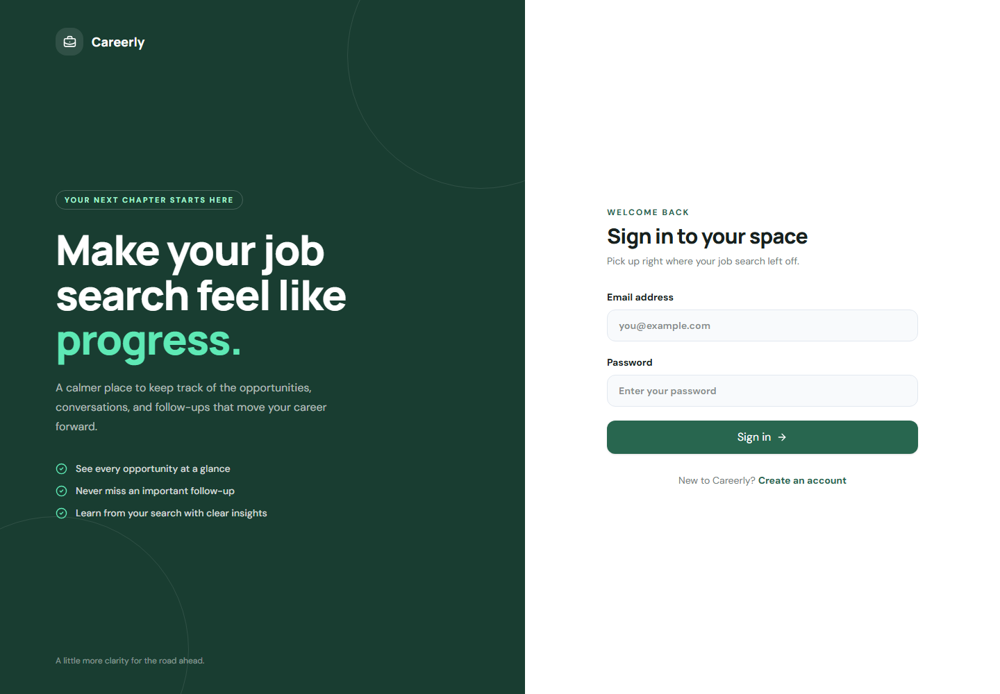
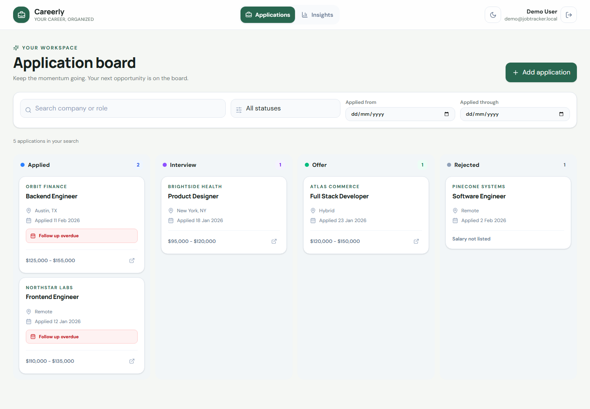
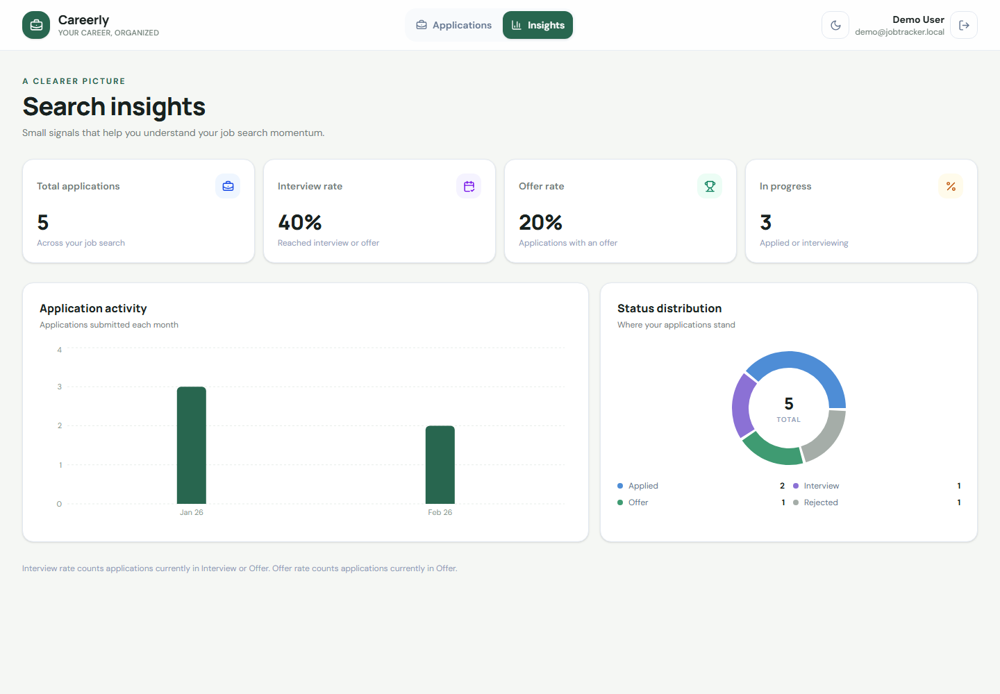

# Careerly — Job Application Tracker

[](https://react.dev/)
[](https://www.typescriptlang.org/)
[](https://vite.dev/)
[](https://tailwindcss.com/)
[](https://nodejs.org/)
[](https://expressjs.com/)
[](https://www.postgresql.org/)
[](https://www.prisma.io/)

Careerly is a full-stack job search workspace for organizing applications, tracking interview progress, and remembering follow-ups. A drag-and-drop Kanban board, search and date filters, and a small analytics dashboard keep the details of a job search easy to scan.

## Screenshots

| Login | Kanban board | Dashboard |
| --- | --- | --- |
|  |  |  |

To regenerate these screenshots, configure the local PostgreSQL database and API environment as described below, install the root development dependencies with `npm install`, and install Playwright's Chromium browser with `npx playwright install chromium`. Then run `npm run screenshots` from the repository root. The script seeds the local database with the generic demo account and sample applications before starting the API and client. Use a local development database only.

## Features

- Account registration and login with bcrypt-hashed passwords and seven-day JWT access tokens.
- Protected API routes and user-scoped job reads, updates, and deletes.
- Drag-and-drop Kanban columns for Applied, Interview, Offer, and Rejected.
- Create, edit, and delete applications, including optional links, salary, notes, and follow-up dates.
- Search by company or position; filter by status and applied-date range.
- Reminders visually mark follow-ups due today or overdue.
- Analytics for application totals, per-status counts, monthly submissions, interview rate, and offer rate.
- Responsive layout, loading and error states, and a persisted light/dark theme.
- Prisma migrations and an idempotent sample-data seed script.

## Tech stack

| Area | Technologies |
| --- | --- |
| Client | React 18, TypeScript, Vite, Tailwind CSS 4, React Router 7, Axios |
| Interactions and charts | dnd-kit, Recharts, Lucide |
| API | Node.js, Express, TypeScript |
| Data | PostgreSQL, Prisma ORM |
| Authentication and validation | JWT, bcrypt, Zod |

## Project structure

```text
.
├── .gitignore
├── LICENSE
├── README.md
├── package.json
├── render.yaml
├── scripts/
│   └── take-screenshots.js
├── client/
│   ├── .env.example
│   ├── index.html
│   ├── package.json
│   ├── tsconfig.json
│   ├── vercel.json
│   ├── vite.config.ts
│   └── src/
│       ├── App.tsx
│       ├── main.tsx
│       ├── index.css
│       ├── components/
│       │   ├── board/       # Kanban board, columns, and draggable cards
│       │   ├── common/      # App layout, route guard, loading and errors
│       │   ├── dashboard/   # Summary cards and charts
│       │   └── jobs/        # Application form, modal, filters, delete dialog
│       ├── context/         # Authentication and theme providers
│       ├── hooks/           # Auth, jobs, stats, and theme hooks
│       ├── pages/           # Login, registration, board, dashboard, 404
│       ├── services/        # Axios client and API services
│       └── types/           # Auth, job, and analytics types
└── server/
    ├── .env.example
    ├── package.json
    ├── tsconfig.json
    ├── prisma/
    │   ├── schema.prisma
    │   ├── migrations/
    │   └── seed.ts
    └── src/
        ├── app.ts
        ├── index.ts
        ├── config/
        ├── controllers/
        ├── middleware/
        ├── routes/
        ├── schemas/
        ├── services/
        ├── types/
        └── utils/
```

## Local setup

### Prerequisites

- Node.js 20 or later and npm.
- PostgreSQL 15 or later, running locally or hosted (Neon and Supabase both offer hosted PostgreSQL plans).

### 1. Clone the project and set up PostgreSQL

Clone the repository:

```sh
git clone <your-repository-url>
cd job-application-tracker
```

Install PostgreSQL using the [official downloads](https://www.postgresql.org/download/) for your operating system, or create a hosted PostgreSQL database with [Neon](https://neon.tech/) or [Supabase](https://supabase.com/).

Create an empty PostgreSQL database named `job_tracker` and a database user with permission to access it. Keep the database password private. If it contains URL-special characters, URL-encode them in `DATABASE_URL`.

### 2. Configure and migrate the API

From the repository root:

```powershell
cd server
Copy-Item .env.example .env
npm install
npx prisma generate
npx prisma migrate dev --name init
npm run prisma:seed
npm run dev
```

Before running the migration, edit `server/.env`: set `DATABASE_URL` to your database connection string and replace the example `JWT_SECRET` with a randomly generated secret of at least 32 characters. Keep `.env` out of version control. The commands above migrate the schema, seed demo data, and start the API.

The API listens on `http://localhost:4000` by default. Check `GET http://localhost:4000/api/health` to verify it is running. The seed script creates or updates the demo account configured by `SEED_NAME`, `SEED_EMAIL`, and `SEED_PASSWORD` in `.env`, then upserts five example applications. Change the demo password anywhere other than a local development database.

### 3. Configure and start the client

In a second terminal from the repository root:

```powershell
cd client
Copy-Item .env.example .env
npm install
npm run dev
```

Open `http://localhost:5173`. The client defaults to `http://localhost:4000/api`; set `VITE_API_URL` in `client/.env` if the API is hosted elsewhere. Register an account or sign in with the configured seed account.

### Environment variables

Copy each `.env.example` to `.env` for local development and supply your own values. Never commit `.env` files, passwords, database URLs, or JWT secrets.

#### Client (`client/.env.example`)

| Variable | Required | Description |
| --- | :---: | --- |
| `VITE_API_URL` | Yes | API base URL, including `/api` (local default: `http://localhost:4000/api`). |

#### Server (`server/.env.example`)

| Variable | Required | Description |
| --- | :---: | --- |
| `NODE_ENV` | No | `development`, `test`, or `production`; defaults to `development`. |
| `PORT` | No | HTTP port; defaults to `4000`. Hosts such as Render or Railway supply this in production. |
| `DATABASE_URL` | Yes | PostgreSQL connection URL, including credentials and database name. |
| `JWT_SECRET` | Yes | Private random signing secret of at least 32 characters. Do not use the example value in production. |
| `CLIENT_URL` | No | Exact frontend origin allowed by production CORS; defaults to `http://localhost:5173`. |
| `SEED_NAME` | No | Display name used by the optional seed script. |
| `SEED_EMAIL` | No | Email used by the optional seed script. |
| `SEED_PASSWORD` | No | Password used by the optional seed script; change it before seeding a shared or production database. |

### Demo login

The seed script provides this generic local-development account:

| Email | Password |
| --- | --- |
| `demo@jobtracker.local` | `Demo12345` |

These credentials are for a locally seeded database only. Do not use them for a public deployment; register a personal account instead.

### Production builds

Build each application from its own directory:

```powershell
# server/
npm install
npx prisma generate
npm run build
npm start

# client/
npm install
npm run build
npm run preview
```

## API

All routes are prefixed with `/api`. Protected endpoints require:

```http
Authorization: Bearer <accessToken>
```

Job status values are uppercase: `APPLIED`, `INTERVIEW`, `OFFER`, and `REJECTED`. Date inputs use `YYYY-MM-DD`. JSON errors use `{ "error": { "message": "...", "details": [] } }`; validation details are included when available.

| Method | Endpoint | Auth | Description |
| --- | --- | :---: | --- |
| `POST` | `/api/auth/register` | No | Register with `{ "name", "email", "password" }`; returns `user` and `accessToken`. |
| `POST` | `/api/auth/login` | No | Sign in with `{ "email", "password" }`; returns `user` and `accessToken`. |
| `GET` | `/api/auth/me` | Yes | Return the current user. |
| `GET` | `/api/jobs` | Yes | List the caller's jobs. Optional query parameters: `search`, `status`, `from`, `to`. Date filters apply to `appliedDate` and include the boundary days. |
| `POST` | `/api/jobs` | Yes | Create a job. Required: `company`, `position`. Optional: `location`, `jobUrl`, `salary`, `status`, `appliedDate`, `followUpDate`, `notes`. |
| `PUT` | `/api/jobs/:id` | Yes | Update one or more job fields. |
| `PATCH` | `/api/jobs/:id/status` | Yes | Change status with `{ "status": "INTERVIEW" }`. |
| `DELETE` | `/api/jobs/:id` | Yes | Delete a job; returns `204 No Content`. |
| `GET` | `/api/stats` | Yes | Return totals, counts by status, monthly submissions, interview rate, and offer rate. |
| `GET` | `/api/health` | No | Simple API health check. |

The interview rate is the share of applications currently in `INTERVIEW` or `OFFER`; the offer rate is the share currently in `OFFER`. Both rates are percentages of all of the user's applications.

There is no server-side logout endpoint: the client logs out by removing its locally stored access token.

## Deployment

Deploy the API to Render, use Neon for hosted PostgreSQL, and deploy the static Vite client to Vercel. Use a separate production database and keep all credentials out of source control.

### Database on Neon or Supabase

1. Create a PostgreSQL project/database in [Neon](https://neon.tech/) or [Supabase](https://supabase.com/).
2. Copy its connection string and configure it as the API's `DATABASE_URL` environment variable. Include `?schema=public` if the provider URL does not already select a schema.
3. Keep credentials private. Use the provider-recommended direct connection string for Prisma migrations.

### API on Render

1. In Render, choose **New → Blueprint** and select this GitHub repository. The root `render.yaml` defines a free Web Service with its root directory set to `server`.
2. When prompted, provide `DATABASE_URL` from Neon, a unique `JWT_SECRET` of at least 32 characters, and `CLIENT_URL` as the exact Vercel site origin (for example, `https://your-project.vercel.app`, with no trailing slash or `/api`). `NODE_ENV` is set to `production` by the Blueprint.
3. The Blueprint build command is:

   ```sh
   npm ci && npm run prisma:generate && npm run build
   ```

4. Its start command applies committed migrations before starting the API:

   ```sh
   npx prisma migrate deploy && npm start
   ```

5. After deployment, check `https://<your-api-host>/api/health`.

Prisma CLI is a production dependency because the start command uses it to apply migrations.

### API on Railway

1. Create a Railway PostgreSQL service and an API service from the repository.
2. Set the API service root directory to `server` and provide a `DATABASE_URL` reference to the PostgreSQL service's connection string.
3. Set the build command to `npm ci && npx prisma generate && npm run build`.
4. Set the start command to `npx prisma migrate deploy && npm start`. This applies the committed Prisma migrations before the server starts.
5. Configure `NODE_ENV=production`, `DATABASE_URL` (from Neon, Supabase, or Railway PostgreSQL), a unique `JWT_SECRET` (at least 32 characters), and `CLIENT_URL` with the exact Vercel frontend origin. Railway supplies `PORT`.
6. Verify `/api/health` on the deployed API domain.

### Client on Vercel

1. Import the repository into Vercel and set the project root directory to `client`.
2. Use `npm run build` as the build command and `dist` as the output directory.
3. Set the production environment variable `VITE_API_URL` to the deployed API base URL, including `/api` (for example `https://your-api.example.com/api`).
4. Deploy the client. Set the API's `CLIENT_URL` to the resulting Vercel origin, then redeploy the API if that value changed.
5. For a custom domain, update `CLIENT_URL` to that origin as well. CORS only allows the configured client origin in production.

The `client/vercel.json` rewrite sends client-side routes back to `index.html`, so refreshing `/board` or `/dashboard` works on Vercel. Set the API's `CLIENT_URL` to the deployed Vercel origin and redeploy the API if the value changed.

### Seed the online demo account (optional)

After the API has deployed and applied its migrations, temporarily set a unique `SEED_PASSWORD` in the Render service environment, then open its Shell and run:

```sh
node dist/prisma/seed.js
```

The idempotent seed creates or updates `demo@jobtracker.local` and adds sample jobs. Save the password you selected for the demo login, then remove `SEED_PASSWORD` from the service environment. Do not use the local-development fallback password for a publicly accessible deployment.

## Future improvements

- Add automated API and component tests, plus CI checks.
- Add refresh-token rotation and server-side session revocation.
- Add pagination, bulk updates, and CSV import/export.
- Support custom statuses and configurable reminder notifications.
- Add richer analytics, time-to-hire metrics, and exportable reports.

## License

This project is licensed under the MIT License. See [LICENSE](./LICENSE) for details.
